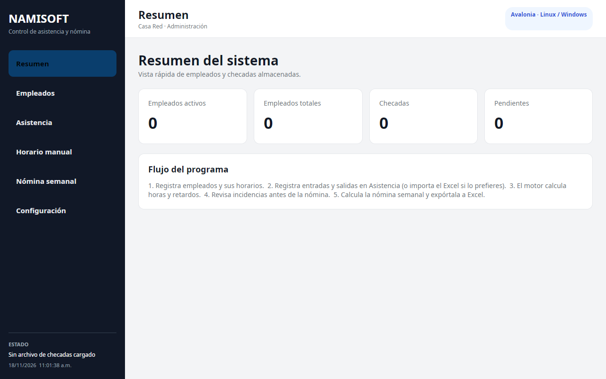
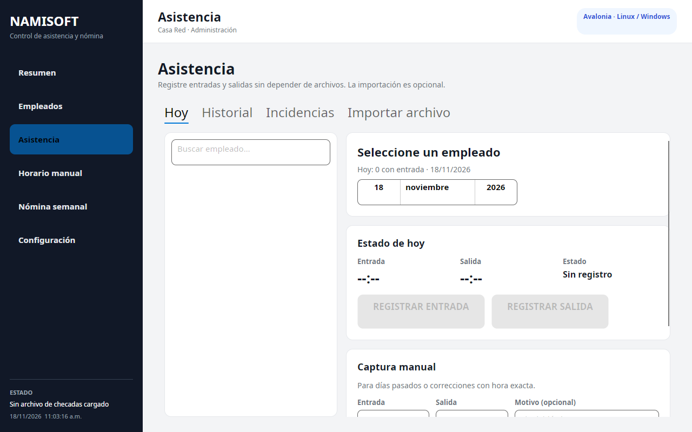
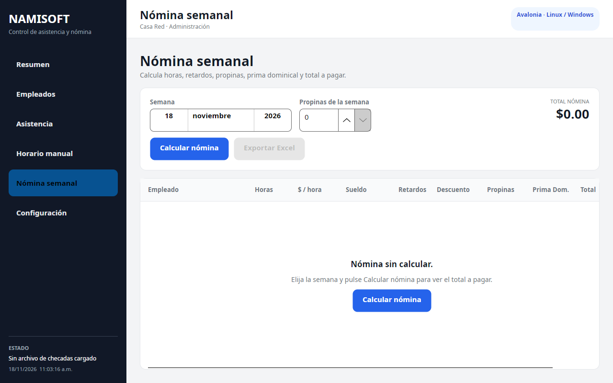

# NamiSoft

Sistema de control de asistencia y nómina semanal para operación con pantalla
táctil en Windows, desarrollado y probado en Linux/Pop!_OS.
Repositorio público: <https://github.com/Elnegraso23/NamiSoft>.

Stack: C# + .NET 10 + Avalonia UI + MVVM (CommunityToolkit.Mvvm) +
Entity Framework Core 10 + Microsoft SQL Server 2022. Sin componentes de pago
(ver `THIRD_PARTY_LICENSES.md`).

## Capturas

### Resumen del sistema


### Asistencia (reloj táctil)


### Nómina semanal


## Estado actual (2026-09-12)

- Migración WinForms → Avalonia completa. Cero `System.Windows.Forms`.
- Módulo **Asistencia** con registro interno (ya no depende de Excel;
  la importación queda como opción en su pestaña).
- `ChecadaEmpleado` con trazabilidad: origen, creación, modificación, motivo.
- Migraciones EF con línea base sin pérdida de datos (`EnsureMigrated`).
- Sistema de diseño táctil (48px+), navegación lateral con sección activa,
  estados vacíos accionables, E/S pesada fuera del hilo UI.
- Compila en `net10.0` con 0 errores. Verificado con capturas reales en Linux.

## Instalación rápida (Linux y Windows)

No necesitas instalar .NET SDK ni Visual Studio: los instaladores descargan
la versión compilada (`self-contained`) desde
[GitHub Releases](https://github.com/Elnegraso23/NamiSoft/releases/latest).

### 1. Instalar la aplicación

- **Linux (terminal):**
  ```bash
  curl -fsSL https://raw.githubusercontent.com/Elnegraso23/NamiSoft/main/install.sh | bash
  ```
  Instala en `~/.local/share/NamiSoft`, crea el comando `namisoft` en
  `~/.local/bin/namisoft` y agrega **NamiSoft** al menú de aplicaciones.

- **Windows (PowerShell):**
  ```powershell
  irm https://raw.githubusercontent.com/Elnegraso23/NamiSoft/main/install.ps1 | iex
  ```
  Instala en `%LOCALAPPDATA%\NamiSoft` y crea accesos directos en el
  Escritorio y en el Menú Inicio.

### 2. Configurar SQL Server 2022 (obligatorio antes del primer arranque)

NamiSoft usa **Microsoft SQL Server 2022** y crea la base de datos y las
tablas automáticamente al iniciar (`EnsureMigrated`).

#### Opción A: Linux (contenedor con Podman o Docker)

```bash
# 1) Levantar SQL Server 2022 en el puerto 1433
podman run -d --name mssql-bd --restart=unless-stopped \
  -e ACCEPT_EULA=Y -e "MSSQL_SA_PASSWORD=<tu_password>" -e MSSQL_PID=Developer \
  -p 1433:1433 mcr.microsoft.com/mssql/server:2022-latest

# 2) Guardar la contraseña para que NamiSoft la lea automáticamente
mkdir -p ~/.config/namisoft
printf '%s' '<tu_password>' > ~/.config/namisoft/mssql.pass
chmod 600 ~/.config/namisoft/mssql.pass
```

*(Si usas Docker, reemplaza `podman` por `docker`.)*

#### Opción B: Windows (SQL Server local o en red)

- **Con usuario `sa`:** guarda la contraseña en
  `%USERPROFILE%\.config\namisoft\mssql.pass` (en PowerShell):
  ```powershell
  New-Item -ItemType Directory -Path "$env:USERPROFILE\.config\namisoft" -Force | Out-Null
  Set-Content -Path "$env:USERPROFILE\.config\namisoft\mssql.pass" -Value "<tu_password>" -NoNewline
  ```
  Si el servidor está en otro equipo o usas otro nombre de base, define las
  variables de entorno de usuario `NAMISOFT_DB_SERVER` (por defecto
  `localhost,1433`) y `NAMISOFT_DB_NAME` (por defecto `NamiSoft`).

- **Con autenticación de Windows (sin usuario `sa`):** define la cadena
  completa en la variable de entorno `NAMISOFT_DB_CONNECTION`:
  ```powershell
  [Environment]::SetEnvironmentVariable(
    "NAMISOFT_DB_CONNECTION",
    "Server=localhost;Database=NamiSoft;Trusted_Connection=True;Encrypt=True;TrustServerCertificate=True",
    "User"
  )
  ```

Orden de resolución de conexión en `Datos/NominaDatabase.cs`:
1. `NAMISOFT_DB_CONNECTION` (cadena completa).
2. `NAMISOFT_DB_PASSWORD` (+ `NAMISOFT_DB_SERVER` / `NAMISOFT_DB_NAME` opcionales).
3. Archivo `mssql.pass` junto al ejecutable o en `~/.config/namisoft/mssql.pass` (`%USERPROFILE%\.config\namisoft\mssql.pass`).

*(Opcional)* Esquema manual para SSMS: `sql/NamiSoft_SQLServer.sql` (crea la
base, tablas y datos iniciales de forma idempotente).

### 3. Abrir NamiSoft

- **Linux:** desde el menú de aplicaciones (**NamiSoft**) o ejecutando `namisoft`.
- **Windows:** desde el acceso directo del Escritorio o Menú Inicio.

### Publicar una nueva versión

El workflow `.github/workflows/release.yml` compila y publica automáticamente
`NamiSoft-linux-x64.tar.gz` y `NamiSoft-win-x64.zip` al subir un tag `v*`
(o ejecutándolo manualmente desde *Actions*):

```bash
git tag v1.0.2
git push origin v1.0.2
```

## Cómo correrlo en desarrollo (desde código fuente)

Requisitos: .NET SDK 10 (`dotnet --list-sdks` debe mostrar `10.x`) y SQL Server
2022 configurado como en el paso anterior.

```bash
./run-linux.sh        # Linux: restore + build + run
```

```powershell
./run-windows.ps1     # Windows PowerShell: restore + build + run
```

O manualmente:

```bash
dotnet build NamiSoft.csproj
dotnet run
```

## Módulos

| Sección | Qué hace |
|---|---|
| Resumen | KPIs (activos, totales, checadas, pendientes) y flujo del programa |
| Empleados | Alta, edición, activar/desactivar, eliminar (con confirmación), sincronizar pendientes |
| Asistencia → Hoy | Reloj táctil: entrada/salida con antiduplicados, captura manual, registros del día |
| Asistencia → Historial | Últimos 7 días del empleado |
| Asistencia → Incidencias | Falta entrada/salida, modificadas; revisar antes de nómina |
| Asistencia → Importar | Excel opcional con la misma validación y tabla que el registro interno |
| Horario manual | Corrección semanal de entrada/salida (delega el cálculo, no duplica reglas) |
| Nómina semanal | Cálculo + aviso de incompletas (no bloquea) + exportación a Excel |
| Configuración | Turnos, tolerancias, descuentos por retardo, prima dominical |

## Datos y migraciones

- Motor: **Microsoft SQL Server 2022** (`Microsoft.EntityFrameworkCore.SqlServer` 10.x).
- Acceso centralizado en `Datos/NominaDatabase.cs`. La UI no conoce cadenas de
  conexión ni SQL.
- Migraciones EF Core en `Datos/Migrations/` (`EnsureMigrated` crea la base y
  aplica cambios pendientes al arrancar sin pérdida de datos).
- Dinero siempre en `decimal`. `Guardar` de empleado es atómico (transacción).
- La contraseña nunca se versiona en el repositorio (`mssql.pass` o variables de entorno).

## Estructura

```text
├── Datos/          NominaDatabase (factory), NominaContext, Migrations/
├── Enumeraciones/  TipoHorario, OrigenChecada
├── Modelos/        Entidades y DTOs
├── Servicios/      Reglas de negocio (sin UI)
├── Utilidades/     Lectura de Excel
├── UI/             Diálogos multiplataforma, AppState
├── ViewModels/     Estado y comandos por pantalla
├── Views/          AXAML + code-behind solo visual
└── Styles/         Sistema de diseño (AppStyles.axaml)
```

Reglas: Views sin acceso a BD; ViewModels sin SQL; sin excepciones sin manejar
hacia la UI; operaciones pesadas con `Task.Run`; botones táctiles ≥48px.

## Pendientes conocidos

- Respaldos automáticos programados de la base de datos SQL Server.
- Pruebas automáticas de `MotorNomina` y `NominaService`.
- Probar el instalador universal `install.ps1` en el equipo Windows real.
- Comparar nómina WinForms vs NamiSoft con la misma BD antes de producción.
- Ver detalle de avance por fase en `MIGRACION.md`.

## Notas de desarrollo

- Los cambios se verifican con `dotnet build` y capturas reales de la app
  corriendo en X11 (capturas vía `xwd`; la navegación sintética con
  `xdotool` falla si la sesión está en uso — en ese caso verificar a mano).
- Sintaxis de bindings a cuidar: `PlaceholderText` (no `Watermark`),
  sin `Padding` en `StackPanel`, negación `!Flag` válida en `IsVisible`.
- `DbContextAttribute` vive en `Microsoft.EntityFrameworkCore.Infrastructure`
  (requerido para que EF descubra las migraciones en runtime).
- Commits en español, rama `main`, remoto `origin → Elnegraso23/NamiSoft`.
